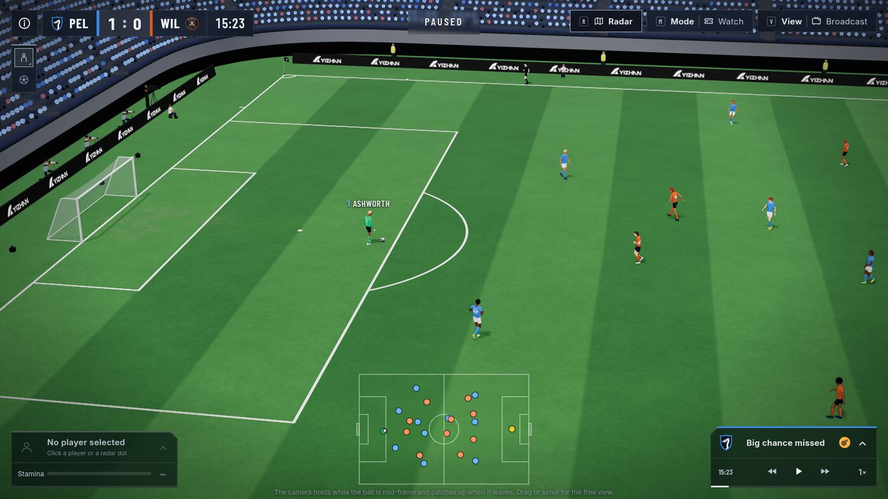
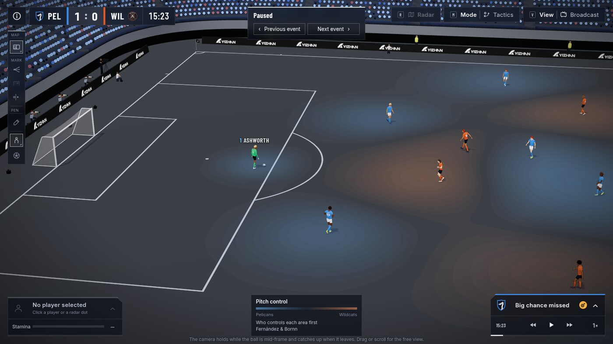
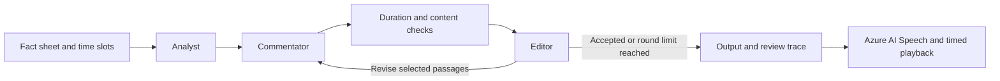

# Pitch Pilot

**Watch the play. Understand the decision. Explore the possibility.**

Pitch Pilot turns football moments into an interactive 3D broadcast: change the camera, follow an explanation,
inspect the tactics, or ask what might happen after a different pass or run. It connects what a viewer sees to
the decisions that made the moment matter.

**[Try the full demo](https://pitch-pilot.projkick.com/)** · Desktop or laptop browser with WebGL · No sign-in

Built for Microsoft's **Inside the Game: Developer Hackathon**, presented with the Premier League.
This is an independent submission, not an official Microsoft or Premier League product.



## Four ways to explore a moment

| Mode | Experience |
|---|---|
| **Watch** | Follow the action through broadcast, tactical and player cameras, with a radar, player cards and replay controls. |
| **Explain** | Follow directed replays with commentary, synchronized subtitles, camera cuts and on-pitch markings. |
| **Tactics** | Inspect pitch control, passing options, the offside line and other overlays; draw on a frozen frame. |
| **What-if — beta** | Change a supported pass or run and explore a modelled continuation. It is a simulation, not an observed outcome. |

A match summary connects individual moments to statistics, passing networks, attacks, heat maps and running.
Explain is available for selected directed clips; What-if is available for supported moments.



## Microsoft AI, with a checkable handoff

Three agents prepare Explain commentary in **Microsoft Foundry**, coordinated with **Microsoft Agent Framework**:

1. **Analyst** plans the story and the facts each passage can use.
2. **Commentator** writes to the passage's time budget and revises the passages sent back.
3. **Editor** reviews grounding, timing, tone and continuity.

A deterministic check between writing and review flags unsupported names, forbidden wording, overly long
passages and subtitle clauses. In the production authoring pipeline, **Azure AI Speech** measures spoken duration
and produces the narration. Human feedback can send selected passages through revision again.



The workflow records drafts, checks, reviews and call metadata. Reaching the round limit does **not** imply
approval: unresolved passages remain flagged for a person. Numerical checks assist the Editor; they are not a
proof of factual correctness. Commentary is authored offline, so the viewer does not wait for a live model call.
**Azure Static Web Apps** hosts the full demo.

See [the agent example](agents/README.md) and [architecture and limitations](docs/architecture.md).

## Run this public source

This repository includes the application source and self-contained verification examples. It excludes licensed
match packages, proprietary trained parameters and the private data preparation pipeline.

### 3D source preview

With Node 24 LTS and npm:

```sh
cd web
npm ci
npm run dev
```

Open **http://127.0.0.1:5174/**. The default page uses the application's pitch, stadium and player renderer with
an entirely hand-authored synthetic scene. No match feed, model download or cloud account is required. It is
labelled **Synthetic fixture** and demonstrates rendering, camera interaction and playback, not the production
model's accuracy. The illustrative threat surface in this public copy is also hand-authored, not fitted xT.

The full data-dependent application remains at `web/src/GameApp.tsx` and can be opened at `/app.html` when a
separately authorized, compatible local data pack is supplied. That pack is not distributed here.

### Agent workflow without cloud calls

With [uv](https://docs.astral.sh/uv/) and Python 3.12:

```sh
uv sync --project agents --frozen
uv run --project agents python agents/example.py
```

This executes the real Agent Framework workflow with scripted agents and an invented fact sheet. It deliberately
starts with an overlong passage, demonstrates review and revision, and writes `artifacts/agent-example.json`.
Speech duration is estimated in this example; no Azure service is called. Live Foundry modes are explicit opt-ins
and may incur usage charges; see [agents/README.md](agents/README.md).

### Checks

```sh
cd web
npm run build
npm run lint
npm test
node --test scripts/*.node-test.mjs
```

From the repository root:

```sh
python3 scripts/audit_public.py
python3 -m unittest discover -s tests
python3 -m unittest discover -s service/tests
uv run --project agents python -m unittest discover -s agents/tests
```

## What is public, and what is private?

| Public | Kept outside this repository |
|---|---|
| 3D application and interaction source | Raw and processed licensed match data, including encrypted copies |
| Foundry agent roles, orchestration and content checks | Trained weights, fitted numerical surfaces and training experiments |
| Public interfaces and invented test fixtures | Private data adapters, identity mappings and original feeds |
| Build configuration, tests and documentation | Credentials, deployment tokens and access documents |

The included [inference service prototype](service/README.md) defines a server boundary for future private
inference. It is **not deployed or wired into the full demo**. It fails closed when no private adapter is installed;
its optional demonstration mode returns explicitly synthetic results.

The current full demo still performs model inference and data decryption in the browser. Browser-delivered
weights and decrypted display data can be recovered by a viewer. Encrypting downloadable files is not a secrecy
guarantee against a client that can decrypt them. Moving confidential inference behind a service is planned work,
not a claim about the current deployment.

## Data, scope and responsible presentation

The full demo uses licensed Hawk-Eye tracking/body poses and Opta events/statistics under the team's stated
non-commercial permission. Teams and people are presented with fictional identities. **These recordings are real
match data with fictional identities; anonymization does not make them synthetic.** The public code examples are
independently invented. The event's synthetic-data requirement remains a separate organizer clarification.

What-if results are modelled possibilities, not historical facts or causal proof. This is a replay prototype, not
a verified live broadcast ingestion service. The current user experience and narration are in English; multilingual
delivery is not implemented. See [the requirement mapping](docs/judging.md) for implemented capabilities and gaps.

## Code map

| Path | Purpose |
|---|---|
| `web/src/three/` | Pitch, stadium, cameras, players and visual overlays |
| `web/src/hud/` | Replay controls, menus, player cards and tactical UI |
| `web/src/explain/`, `web/src/orchestrate/` | Directed replay and explanation playback |
| `web/src/whatif/`, `web/src/response/` | What-if interaction and inference consumer code; trained parameters excluded |
| `web/src/sample/` | Self-contained synthetic source preview |
| `agents/` | Foundry authoring workflow and invented offline example |
| `service/` | Local private-inference interface prototype and contract tests |
| `scripts/audit_public.py` | Publication boundary checks |

## Credits and rights

Hawk-Eye (Sony) and Opta (Stats Perform) provide the licensed match sources. Production xG/xT work uses StatsBomb
open data; pitch-control methods draw on Fernández and Bornn and Spearman. Mixamo supplies production motion
assets. React, three.js, React Three Fiber, drei, Framer Motion and the credited fonts support the application.
The synthetic source preview uses hand-authored poses, not Mixamo motion files.

See [third-party notices](THIRD_PARTY_NOTICES.md). Copyright © 2026 Yizhan. All rights reserved; public visibility
does not grant an open-source licence. See [LICENSE](LICENSE).
