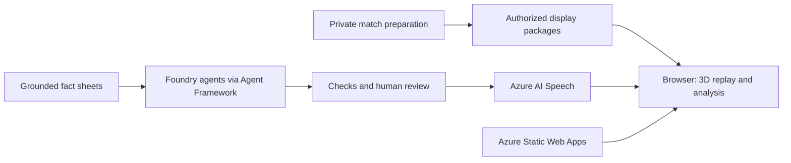

# Architecture and release boundaries

## Current demo

The current browser consumes prerecorded match packages. Explain commentary and narration are prepared offline.
What-if inference currently runs in the browser. The application is not a live event-stream ingestion backend.

## Public source

The default entry renders a formula-generated fixture using the existing pitch, stadium and player renderer.
It requires no private dataset and is intentionally narrower than the full demonstration. The public agent entry
runs the existing workflow with scripted responses and a separately invented fact sheet.

Fitted xG/xT surfaces, movement weights, model fitting scripts, licensed feeds and identity mappings are excluded.
The illustrative grid in `web/src/sample/threat.ts` is not a production metric. Source files that consume models
remain useful for understanding interfaces; their presence does not provide the trained artifacts.

## Private inference prototype

`service/` is a local reference boundary for moving the model behind a server. No trained adapter or live
deployment is included. The browser would send a clip ID, timestamp and edited action; the server would resolve
private inputs and return the permitted display result. The default service returns an unavailable error until
an adapter is supplied. Its demonstration mode is explicitly synthetic.

Server-side inference can keep model weights off the client. It cannot make returned results secret from their
recipient. A browser rendering a player's movement must receive a usable representation of that movement.
Strong confidentiality of original coordinates would require a different delivery method, such as server-rendered
video, with different latency and infrastructure costs. This avoids sending the original coordinate arrays;
viewers can still estimate positions and motion from the visible video. It is not a guarantee that no information
about the match can be reconstructed.

## Publication process

This is an allowlisted source distribution with a fresh history, not a copy of the private repository's Git
history. `scripts/audit_public.py` checks common artifact, credential and path mistakes before publication.
Automated checks supplement a manual diff and asset review; they cannot recognize every possible encoded secret
or establish third-party redistribution rights.

Production deployment and repository publication are separate actions. Changes here do not automatically change
the live demo. Cloud deployment requires separate access, configuration, integration and verification.
